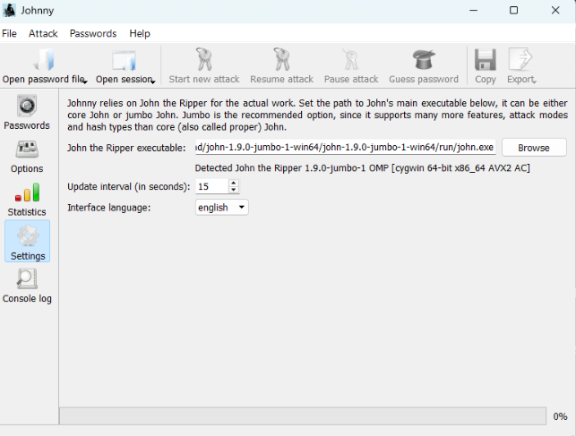
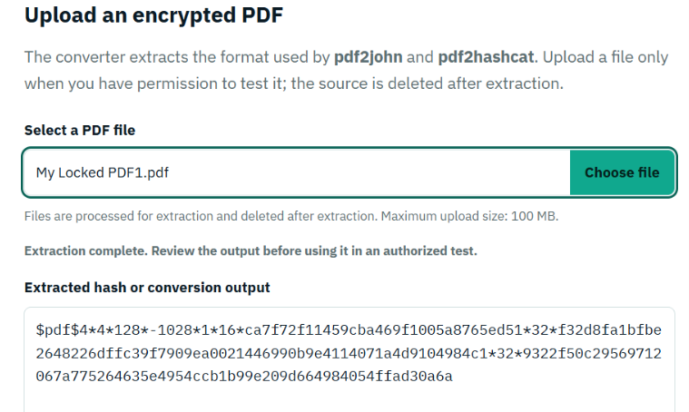
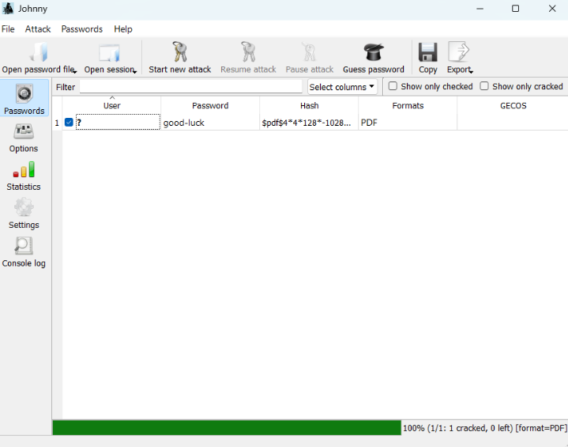
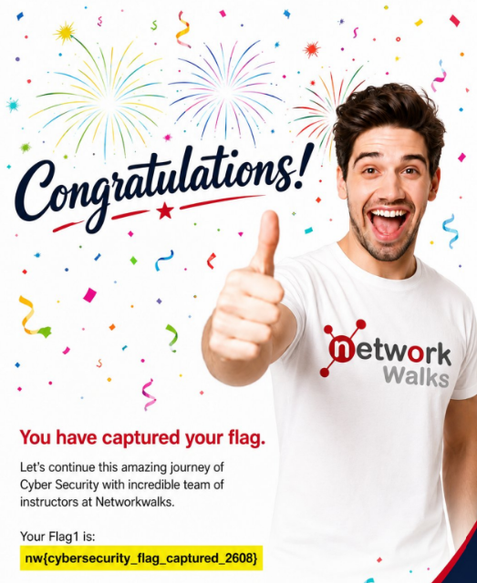
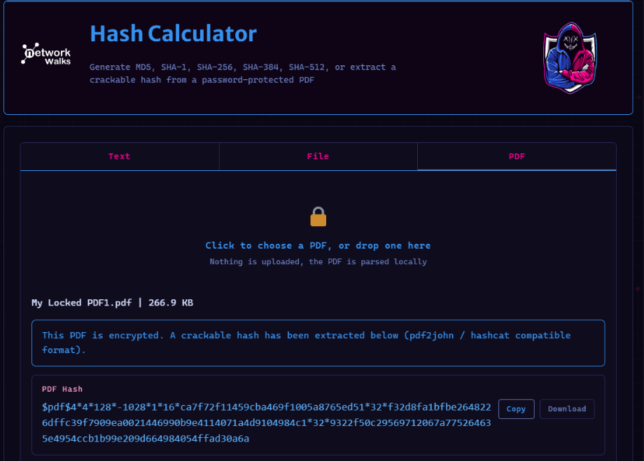
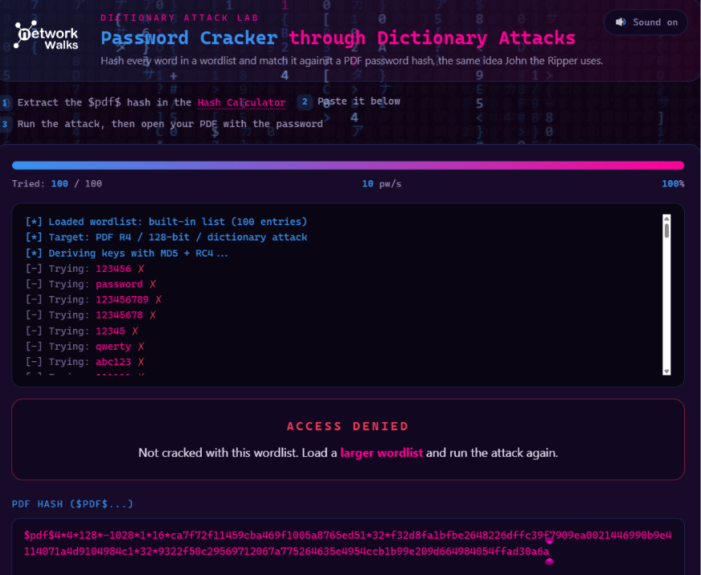
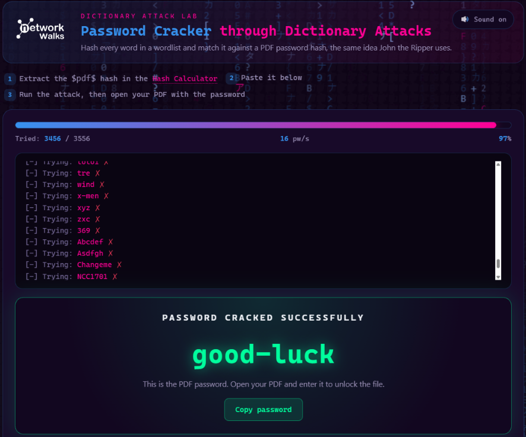

<div align="center">

# 🔑 Password Cracking Lab

**Recovering a PDF password with John the Ripper and with Networkwalks' own hash/cracking tools**
</div>

<p align="center">
  
  
  
  
  
  
  
  
  
  
  
</p>

---

## 📌 Project Overview

This project covers **password cracking**, using the password-protected file `My Locked PDF1.pdf` (a test file created for this lab) as the target.

I completed the exercise two ways:

1. **Module 1 – John the Ripper / Johnny:** extracted the PDF's hash and ran a dictionary attack with the desktop tool **John the Ripper**, using its **Johnny** GUI.
2. **Module 2 – Networkwalks Tools:** repeated the same idea using two free browser-based tools built by Networkwalks — the **Hash Calculator** and the **Password Cracker** — with no installation required.

Both methods target the same file and the same underlying hash, to show that the same password can be recovered whether the attack runs locally with a dedicated tool or through a simple web-based dictionary attack.

> Written permission / authorization: this file was created specifically for this training exercise, so no third-party system or data was involved.

---

## 🎯 Objectives

The main objectives of this project are to:

- Understand how a password-protected file stores its password as a **hash**, not as plain text.
- Extract a crackable hash from a locked PDF (`pdf2john` / hashcat-compatible format).
- Install and configure **John the Ripper** and its **Johnny** GUI on Windows.
- Run a dictionary attack against the hash and recover the real password.
- Use the password to unlock the PDF and confirm the result.
- Repeat the process using Networkwalks' own **Hash Calculator** and **Password Cracker** web tools.
- Understand why wordlist size and password complexity affect whether, and how fast, a password is cracked.

---

## 🛡️ Purpose of Password Cracking

| Concept | What it means |
| ------- | -------------- |
| **Hash** | A one-way scrambled value generated from the password. It cannot be reversed directly. |
| **Dictionary attack** | Hashing every word in a wordlist and comparing it to the target hash until a match is found. |
| **Wordlist size** | A small built-in list is fast but may miss the password; a larger list takes longer but covers more possibilities. |

Security professionals use these techniques to test how strong a password is, and to demonstrate why short or common passwords can be recovered quickly.

---

## 🗺️ Workflow Overview

```text
Module 1: John the Ripper / Johnny          Module 2: Networkwalks Tools
-----------------------------------         ----------------------------
My Locked PDF1.pdf                          My Locked PDF1.pdf
      │                                           │
      ▼                                           ▼
Extract hash (pdf2john format)              Hash Calculator → extract $pdf$ hash
      │                                           │
      ▼                                           ▼
Open hash in Johnny (John the Ripper)       Password Cracker → built-in 100-word list
      │                                           │
      ▼                                           ▼ (not found → Access Denied)
Dictionary attack → password cracked        Load a larger custom wordlist
      │                                           │
      ▼                                           ▼
Password: good-luck                         Attack re-run → password matched
      │
      ▼
Unlock PDF → Flag captured
nw{cybersecurity_flag_captured_2608}
```

---

# Project Procedure

## Module 1. Password Cracking with John the Ripper

### Step 1. Install John the Ripper and Johnny

John the Ripper (jumbo build) and its graphical front-end, **Johnny**, were downloaded and installed on Windows.

### Step 2. Point Johnny to the John the Ripper executable

In Johnny's **Settings**, the path was browsed to `john.exe` inside the John the Ripper `run` folder. Johnny detected it as *John the Ripper 1.9.0-jumbo-1 OMP*.



### Step 3. Extract the hash from the locked PDF

The target file, `My Locked PDF1.pdf`, was uploaded to an online PDF hash extractor, which uses `pdf2john` to convert the file into a crackable hash (`$pdf$...`, hashcat/John-compatible format).



### Step 4. Load the hash into Johnny and run the attack

The extracted hash was saved as a text file and opened in Johnny via **Open password file → Open other file format (\*2john)**. The dictionary attack was started.

### Step 5. Password cracked

Johnny matched the hash and recovered the password:



```text
Password: good-luck
Format:   PDF
Result:   100% (1/1 cracked, 0 left)
```

### Step 6. Unlock the PDF and confirm the flag

The password `good-luck` was entered into the PDF's password prompt, which unlocked the file and revealed a **Congratulations** page confirming the flag.



```text
Flag: nw{cybersecurity_flag_captured_2608}
```

---

## Module 2. Password Cracking with Networkwalks Tools

### Step 1. Extract the hash with the Hash Calculator

The same `My Locked PDF1.pdf` was uploaded to the Networkwalks **Hash Calculator** (browser-based, no install), which extracted the identical `$pdf$...` hash as Module 1.



### Step 2. First attempt — built-in wordlist

The hash was pasted into the Networkwalks **Password Cracker** and run against its **built-in list (100 passwords)**. The list was exhausted without a match:



```text
Tried: 100 / 100   (100%)
Result: ACCESS DENIED — not cracked with this wordlist
```

### Step 3. Second attempt — larger custom wordlist

A larger custom wordlist (3,556 words) was uploaded and the attack was run again:



```text
Tried: 3456 / 3556   (97%)
```

Since this is the same hash cracked in Module 1, the larger list reached the same password, **good-luck**, confirming that a small, generic wordlist can miss a password that a larger or more targeted list will still find.

---

# 🔎 Results Summary

| 🧾 Method | 🛠️ Tool | 🎯 Result |
| --------- | -------- | --------- |
| Dictionary attack (desktop) | John the Ripper via Johnny | Password recovered: `good-luck` |
| Dictionary attack, built-in list (100 words) | Networkwalks Password Cracker | Not cracked — list exhausted |
| Dictionary attack, larger wordlist (3,556 words) | Networkwalks Password Cracker | Password recovered: `good-luck` |
| Flag captured | Adobe Acrobat Reader | `nw{cybersecurity_flag_captured_2608}` |

---

# ⚠️ Risk Analysis

These are observations from a controlled, authorized lab exercise on a file created solely for this purpose, not a real-world attack.

| # | Finding | Evidence | Risk Level |
| - | ------- | -------- | ---------- |
| 1 | A short, dictionary-style password is recoverable with a small wordlist | `good-luck` was cracked in seconds once hashed | 🟠 Medium |
| 2 | Password strength depends entirely on wordlist coverage | The 100-word built-in list missed it; a 3,556-word list found it | 🟡 Low |
| 3 | File-level encryption does not protect a weak password | The PDF's encryption was intact — the weak password, not the encryption, was the weak point | 🟠 Medium |

---

# ✅ Recommendations

1. Use long, random passphrases rather than single dictionary words or simple phrases.
2. Combine uppercase, lowercase, numbers and symbols, and avoid predictable substitutions (e.g. `@` for `a`).
3. Use a password manager to generate and store unique passwords per file or account.
4. Where available, prefer stronger PDF encryption settings (e.g. 256-bit AES) over weaker legacy settings.
5. Never reuse the same password across personal and work-related protected files.
6. Periodically test your own files' passwords against common wordlists to catch weak ones early.

---

# 💡 What I Learned

Through this project, I learned how password cracking works end-to-end, from a protected file down to a recovered plaintext password.

The most important concepts I learned include:

### 1. Hashing vs. Encryption

Encryption is reversible with the right key; hashing is one-way. A locked PDF's password is checked by hashing a guess and comparing it to the stored hash — not by decrypting anything directly.

### 2. pdf2john / Hash Extraction

Tools like `pdf2john` (used here through an online hash extractor and through Networkwalks' Hash Calculator) convert a password-protected file into a hash format that cracking tools like John the Ripper can work with.

### 3. Dictionary Attacks

A dictionary attack only tries the words in a given wordlist. A password missing from the list will never be found, no matter how long the attack runs — which is why wordlist size and relevance matter as much as the cracking tool itself.

### 4. John the Ripper and Johnny

John the Ripper is the engine that performs the cracking; Johnny is a GUI front-end that makes it easier to load a hash file and start an attack without typing commands.

### 5. Same Tool, Different Interfaces

Running the identical attack through a desktop tool (John/Johnny) and through a browser-based tool (Networkwalks Hash Calculator + Password Cracker) produced the same result, which showed me that the underlying concept — hash, then dictionary attack — stays the same regardless of the interface.

### 6. Why Strong Passwords Matter

A weak, common password can be recovered in seconds to minutes. This exercise made the password-strength advice given to end users concrete rather than abstract.

---

# 🔐 Security & Ethical Use

This lab is intended strictly for educational purposes only.

The target file, `My Locked PDF1.pdf`, was created specifically for this exercise. No third-party system, account or real-world file was accessed or tested.

Do not use anything from here to break the law. Cracking a password-protected file you do not own or do not have explicit authorization to test is illegal in most jurisdictions, even when no damage occurs.

---

# 🔗 Tools & Resources

- **John the Ripper:** [https://www.openwall.com/john/](https://www.openwall.com/john/)
- **Johnny (GUI):** [https://openwall.info/wiki/john/johnny](https://openwall.info/wiki/john/johnny)
- **Networkwalks Hash Calculator:** [https://networkwalks.com/hash-calculator/](https://networkwalks.com/hash-calculator/)
- **Networkwalks Password Cracker:** [https://networkwalks.com/password-cracker/](https://networkwalks.com/password-cracker/)

---

# 👤 Author

**Dhruv Tripathi**\
Cybersecurity Intern at Network Walks, Batch B084

LinkedIn: https://www.linkedin.com/in/dhruv-tripathi-735869365

---

## 📌 Project Information

**Program Name:** Cybersecurity at Networkwalks | **Week:** 03 | **Project:** Password Cracking with JTR & Networkwalks Tools (W3-PM1, W3-PM2) | **Repository:** GitHub
